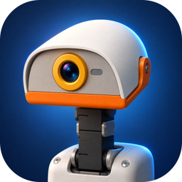
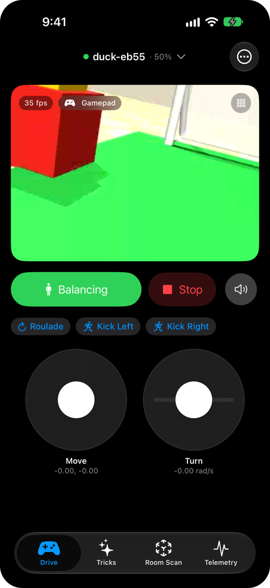
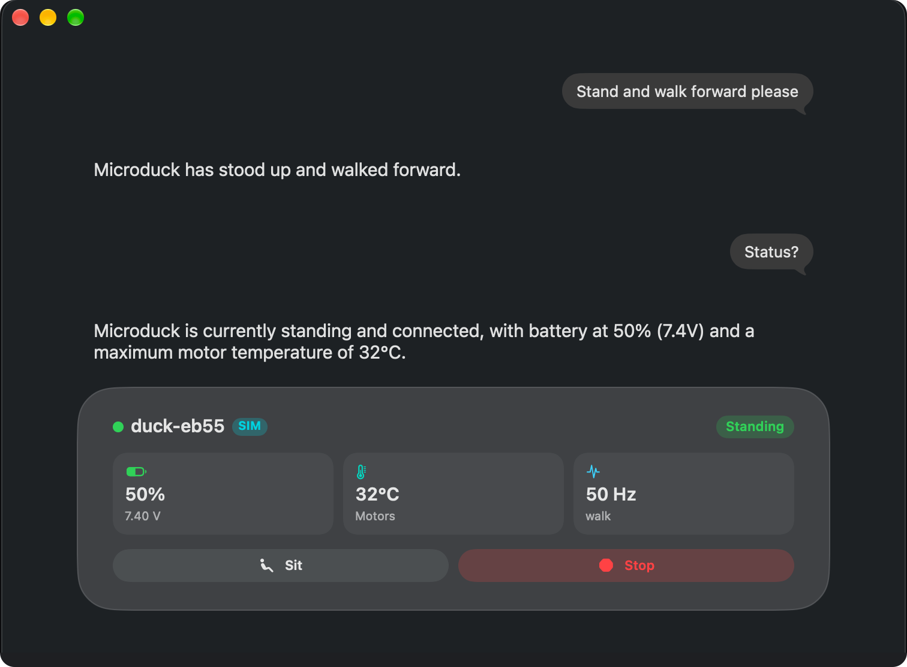

<p align="center">
  
</p>

<h1 align="center">MicroduckRemote</h1>

<p align="center">
  Native SwiftUI + Metal iOS &amp; macOS remote control app for <a href="https://github.com/pollen-robotics/microduck">Microduck</a> — with live WebRTC video, Hugging Face trick installation, LiDAR RoomPlan → MuJoCo scene export, and full iOS/macOS 27.3 Siri AI App Intents.
</p>

<p align="center">
  
  &nbsp;&nbsp;&nbsp;&nbsp;
  
</p>

## Highlights

- **Live Cockpit (iOS & macOS):** 30 fps H.264 Metal camera feed, dual thumbsticks & gamepad driving, head gaze, expressive beak/head-tilt/crouch drawer, **Wingman** in-app `FoundationModels` agent & streaming mission planner (with On-Device / Private Cloud Compute + live camera vision), soundboard, posture/mode controls (including Theremin), and 8×8 ToF depth overlay.
- **Siri AI & App Intents:** 17 `@AppIntent(.tool)` tools (including closed-loop odometry distance, exact degree turns, and ToF clearance approach/backup), 5 `Skills.skillsbundle` playbooks for multi-step orchestration, interactive `CardSnippet` status & proximity cards, `@AppEntity(.generable)` choreographed routines, bounded ToF apartment exploration, `Transferable` camera photos, and live Siri call telemetry.
- **Hugging Face Tricks Gallery:** Browse, download, install, and trigger official and community Microduck policies directly from the Hub.
- **LiDAR Room Scan → MuJoCo:** Scan single or multi-room spaces on iPhone/iPad with Apple RoomPlan, optionally populate collision-free interactive playground props (soccer ball, cones, blocks), and sync ready-to-run MuJoCo XML scenes to macOS via iCloud Drive.
- **macOS Simulator Launcher:** Start, restart, and inspect `scripts/duck-sim` scenes and live daemon logs natively on macOS.

## Live Demos

Recorded directly against live MuJoCo physics + `robotd` + `tofd`:

- **[Demo 1 — Expressive Beak, Head Tilt & Crouch](docs/demos/demo-1-expressive-beak-pose.mp4):** `ControlDuckBeakIntent` (`-4.5°` to `+30.1°` hinged jaw), animated chomp, head tilt, and crouch + chomp routines.
- **[Demo 2 — Swift Shortcuts DSL Workflows](docs/demos/demo-2-shortcuts-dsl.mp4):** End-to-end execution of Swift-authored Shortcuts (`Duck Room Patrol`, `Morning Duck Briefing`, `Duck Photo Tour`) chaining Microduck App Intents with Apple Intelligence.
- **[Demo 3 — Apartment Explorer & Interactive Props](docs/demos/demo-3-apartment-explorer-props.mp4):** LiDAR RoomPlan playground props, 8×8 ToF left/front/right proximity analysis (`GetDuckProximityIntent`), and bounded closed-loop wandering (`ExploreApartmentIntent`).

## Quick Start

Requires **Xcode 27.3+** and **iOS / macOS 27.3+**.

```bash
cp Config/Local.xcconfig.example Config/Local.xcconfig   # optional: set your Team ID & bundle ID for device builds
open MicroduckRemoteWorkspace.xcworkspace
```

Select the **`MicroduckRemote`** (iOS) or **`MicroduckRemoteMac`** (macOS) scheme and press **Run (`⌘R`)**.

## Documentation

Full guides ship as a DocC catalog (`MicroduckRemotePackage/Sources/AppFeature/MicroduckRemote.docc`) — view them in Xcode via **Product › Build Documentation (`⌃⇧⌘D`)** or read directly on GitHub:

| Guide | What's Inside |
| --- | --- |
| [Getting Started](MicroduckRemotePackage/Sources/AppFeature/MicroduckRemote.docc/GettingStarted.md) | Requirements, `Config/Local.xcconfig` signing setup, workspace layout, tests, and `sirimetadataanalyzer` |
| [Simulator & Remote Driving](MicroduckRemotePackage/Sources/AppFeature/MicroduckRemote.docc/SimulatorAndLocalDriving.md) | Launching `scripts/duck-sim` on macOS, Hugging Face Rendezvous + TURN remote login, keyboard shortcuts |
| [Siri AI & App Intents](MicroduckRemotePackage/Sources/AppFeature/MicroduckRemote.docc/SiriAIAndAppIntents.md) | All 17 `@AppIntent(.tool)` tools, 5 `Skills.skillsbundle` playbooks, `CardSnippet` entities, Telemetry, and `SiriEvaluations` |
| [LiDAR Room Scanning](MicroduckRemotePackage/Sources/AppFeature/MicroduckRemote.docc/LiDARRoomScanning.md) | RoomPlan single/multi-room capture, doorway & collision tuning, and iCloud Drive sync to MuJoCo |
| [Architecture](MicroduckRemotePackage/Sources/AppFeature/MicroduckRemote.docc/Architecture.md) | Modular Swift Package targets, cold-start WebRTC lifecycle, 10 Hz deadman/ToF guard, and backward velocity mapping |

## Contributing & License

Contributions are welcome — see [CONTRIBUTING.md](CONTRIBUTING.md). Released under the [MIT License](LICENSE).


